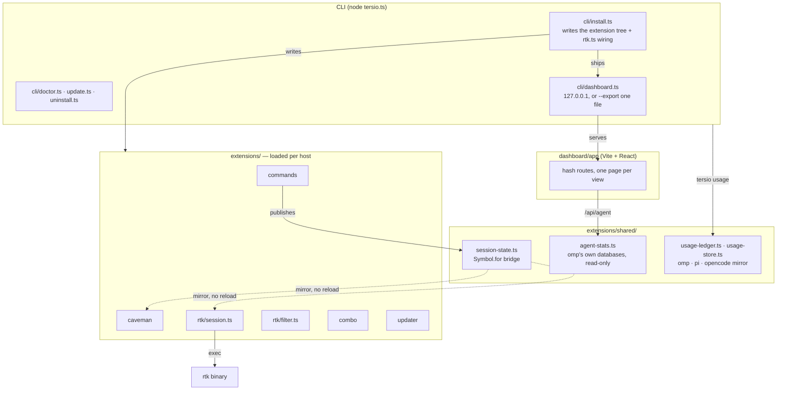
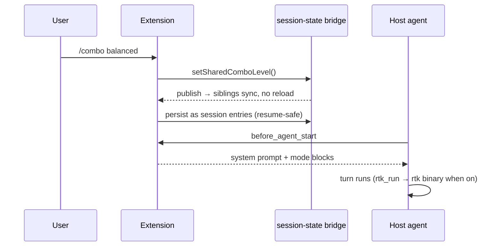
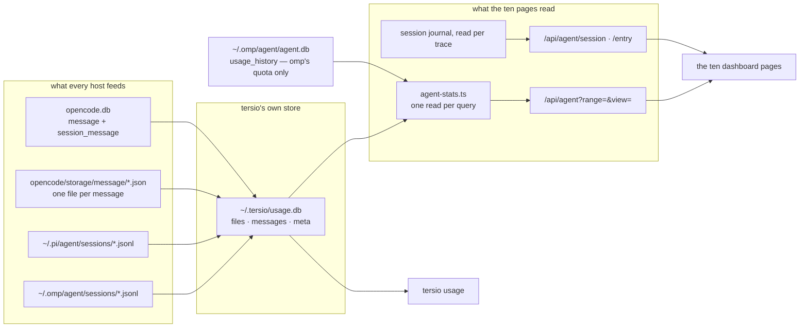

# Architecture

Tersio is one npm package with two faces: a **CLI** (`tersio install|update|doctor|dashboard…`) and a **host plugin** whose feature-gated extensions load inside any supported agent — omp, pi, or OpenCode. The CLI picks one with `--host`, every extension speaks one `ExtensionApi`, and all three read the same session defaults from one file. The reporting side is not yet that even, which the next section spells out.

## Components

## One turn

## Data sources, and the one store both readers share

One read path. **The aggregate and the report read the same store.**

- **One store feeds both readers.** `agent-stats.ts` opens `~/.tersio/usage.db`, the same file `tersio usage` aggregates. Every one of the ten pages — Overview, Models, Providers, Costs, Carbon, Requests, Errors, Traces, Tools, Projects — reads every host: omp, pi, and OpenCode. A dashboard figure and a report figure are the same figure by construction, not by coincidence.
- **The dashboard syncs before it reads.** `cli/dashboard.ts` runs `syncUsageDb()` behind a 15s throttle, so a page reads what the transcripts hold rather than what the last `tersio usage` wrote. The 5s memo still collapses a burst of polls, keyed on the store's own mtime and size.
- **omp's quota snapshots stay omp's.** Only omp records `usage_history`, so the Providers page still reads `~/.omp/agent/agent.db` for it. Nothing in the store replicates them, and the page's window figures degrade to empty when that database is absent.
- **A trace is still a journal read.** `readSessionTrace` and `readAgentRequestEntry` open the session transcript itself, because the store keeps facts, not message bodies. OpenCode writes no `.jsonl`, so its traces keep drawing the empty state, while pi transcripts trace in full from the same reader.
- **What the store does not carry reads as a literal, never as an estimate.** omp's schema held a per-component cost split, a route name, a per-request premium count, and a service tier. The store holds none of these, so `COL` in `agent-stats.ts` maps each to `NULL`, or `''`, in one place: cost reads whole with no split, a route reads empty. The provider column is not stored either, so it derives from the model id's first segment, spelled the way the dashboard marks it. First-token latency *is* stored, in `tf`, and it is omp-only: pi and OpenCode record none, so their rows read null and their latency averages read null rather than zero, because a zero would draw a flat line and claim no wait at all.
- **Every host's tool names are read, from three shapes.** omp and pi transcripts name tools beside the message. OpenCode's v1 JSON tree names them in the message's `content` parts. OpenCode's v2 sqlite puts those parts inside a `data` blob that holds newlines and tabs, so the blob cannot be read through the CLI; the names are extracted inside SQL with `json_each` and `group_concat` instead, and land in the same `tools` list. A store written before that reader holds every OpenCode row at `[]`, so a version marker (`opencode_tools` in `meta`) widens the watermark scan to the whole table exactly once. That marker matters: bumping `PARSER_VERSION` instead rebuilds the store from whatever transcripts still exist, which silently drops the history of every rotated transcript — that is a far larger loss than the one the backfill repairs.
- **An added column backfills itself, and a version bump does not.** Three store columns arrived after the first release: `id`, then `a`, then `tf`. Each one took a bare `ALTER TABLE ... ADD COLUMN`, which moves no row and forces no re-parse, so the existing history survives what a rebuild could not reconstruct from rotated transcripts. The new column then reads NULL on history, which a marker closes: `opencode_tools` widens the OpenCode watermark scan once so old rows gain their tool names, and `ttft_backfill` clears the `files` mtimes once so the ordinary incremental path rewrites each transcript and fills its latency. Both markers are written only after the rows commit, so a sync that dies midway leaves the window open and retries instead of publishing half a backfill. The rule: an additive change never justifies a `PARSER_VERSION` rebuild.
- **The request log ships one capped page, and the page's totals come from the aggregate, not from that page.** A log slice cannot answer "how many requests ran in this window": the cap is 200 rows, and a busy hour produces thousands. So `requestStats` takes its count, failure count, tokens and cost from the `overall` block, which is one exact aggregate row over the whole range, and leaves only the percentiles and the aborted count to the shipped rows. `shipped` records how many those were, and the page labels them, because a p95 over 200 of 2,400 rows describes those 200 only. `?offset=` walks the range back in row-sized steps — the alternative, computing the header from the shipped rows, is what made a full range read as exactly 200 requests with nothing older than an hour reachable.
- **Bucketing needs a cast.** The store keeps timestamps REAL, and a REAL division does not floor, so the bucket expression casts to INTEGER first. Without the cast every row lands in its own bucket and a series reads as noise.

## The aggregate

- **The aggregate mirrors the reference, metric for metric.** `readAgentStats(range, view)` reimplements the omp-stats SQL facts: `failed` counts only `stop_reason = 'error'`, `cacheRate` is `cacheRead / (input + cacheRead)`, and `avgTokensPerSecond` divides by `COUNT(duration > 0)`. The subscription-window engine ports the same rules: a window is one `(provider, limitId)` pair, consumption sums only positive fraction deltas, a drop past 0.05 counts a cycle, and the peak is the swept sum across accounts. Each rule is pinned by `test/cli/omp-stats.test.ts`.
- **A view asks for only what it renders.** `view=<page>` selects the query groups the server runs and the fields it returns, so a payload stays in the tens of kilobytes rather than one snapshot. Reads are memoized for five seconds per range and view.
- **Never a write.** Reads run in process (bun:sqlite, else node:sqlite) and fall back to the `sqlite3` binary, whose WAL traps `extensions/shared/sqlite.ts` handles in order: `-readonly` first, then `immutable=1` only when no `-wal` file exists, then a copy of `db` + `-wal` + `-shm` into a temp directory. Nothing opens read-write, which would create side files in the host's own directory.
- **Range is URL state.** Keys `1`-`6` pick a window and `g` then a letter opens a page. An exported file carries a single window, so its picker is a label, not a control.
- **Degrade by source.** A missing `stats.db` hides the six `agentOnly` pages — Providers, Costs, Carbon, Errors, Traces, Projects — and leaves Overview, Models, Requests, and Tools standing.
- **Two marks, two jobs.** `VendorMark` names the model author, resolved from the model id. `ProviderMark` names the routing service. Marks resolve to URLs from one catalog in `extensions/shared/brand-marks.ts`, never to bytes in the source; `--export` inlines that catalog once so an exported file keeps its logos with the network off.

## Key invariants

- **Bridge, not reload:** `session-state.ts` uses a `Symbol.for` global bridge; a toggle publishes and siblings mirror live. Custom session entries are the persistence layer — `reconcileSharedComboEntries` rebuilds state on resume or branch.
- **Subagents inherit:** `isOmpSubagentPrompt` makes subagent turns read shared state instead of local flags. Detection is text-based on `OMP_SUBAGENT_MARKER`, a verbatim sentence from the host prompt, so a reworded host drops it silently. pi has no built-in subagent prompt, so only omp is detectable by text.
- **Injection appends only:** a mode switch leaves the previous level's text in an accumulating prompt. Removing it needs host support to rewrite the system prompt, which an extension cannot reach.
- **Bridge state is process-global:** the `Symbol.for` bridge and `RTK_DISABLED` are unscoped, so one process serving two sessions would share them. Correct for the single-user hosts this targets.
- **Ledger is best-effort:** append-only JSONL; `tersio reset` writes a watermark instead of deleting host-owned files.
- **The mirror never discards a store from a newer tersio:** a `parser_version` above this build keeps its rows and skips the re-parse, because rotated transcripts cannot rebuild them. `TERSIO_FORCE_REPARSE=1` accepts the loss.
- **Always on:** `omp.extensions` in `package.json` loads every mode extension. Only `updater` stays an optional feature.
- **Single owner:** OMP plugin manifests load Tersio extensions and nested Ponytail. `config.yml` holds only rtk-owned wiring; doctor removes retired, duplicate, or legacy manifest-owned entries. An install removes the agent-tree copies an older build wrote, because a second load of the same file is the bug.
- **Caveman rule ownership:** `extensions/caveman/rule.md` ships beside the manifest-loaded extension. Doctor and updater inspect that installed plugin path, not the retired agent copy.
